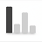
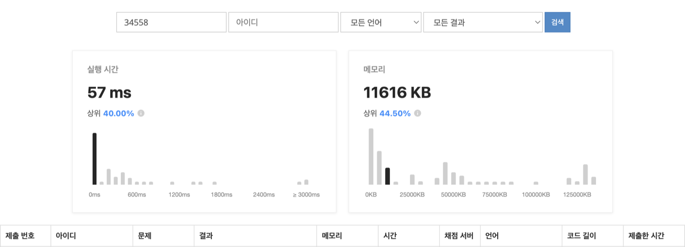

# BOJ Performance

백준 온라인 저지(BOJ)의 채점 현황 페이지에서 내 코드의 실행 시간과 메모리 위치를 직관적인 그래프로 확인할 수 있는 브라우저 확장입니다.
2026년 11월 다시 열린 백준(`acmicpc.net`)에서 동작합니다.
[홈페이지](https://kangkyunghyun.github.io/boj-performance/)에서 사용법과 업데이트 소식을 볼 수 있습니다.

  
  
  
  
  
  
  
  
  

## ✨ 주요 기능

로그인한 상태로 내가 맞은 문제의 채점 현황(`acmicpc.net/status?problem_id=…`)을 열면 결과 표 위에 실행 시간 카드와 메모리 카드가 생깁니다.

### 📊 1. 분포 그래프와 상위 비율
- 그 문제의 최근 정답 제출 최대 200건으로 실행 시간(ms)과 메모리(KB) 분포를 막대 그래프로 보여주고, 내 기록이 든 막대를 강조합니다.
- "상위 15.20%"처럼 내 기록의 상위 비율을 보여줍니다. 안내 아이콘에 비교한 제출 수가 나옵니다.
- 내 기록은 내 최근 정답 제출 20건 가운데 비교 언어로 낸 제출 중 실행 시간이 가장 짧은 제출입니다. 실행 시간이 같으면 메모리가 적은 제출입니다.
- 서로 다른 값이 많은 문제는 분포를 구간으로 묶어 막대가 빽빽하지 않게 보여줍니다. 상위 비율은 묶기 전 값으로 계산합니다.

### 🔄 2. 같은 언어끼리 비교
- 언어 필터를 고르면 그 언어의 정답 제출끼리 비교합니다.
- 언어 필터를 고르지 않으면 모든 언어를 섞지 않고 내가 가장 최근에 맞은 제출의 언어로 비교합니다. 카드 위에 비교 언어가 보이고, 다른 언어로도 맞았다면 그 언어로 바꾸는 링크가 생깁니다.

### ⚡ 3. 같은 탭에서는 새 제출만
- 같은 탭에서 같은 문제를 다시 열거나 결과 표의 다음 페이지로 넘기면 앞서 받은 기록으로 바로 보여주고, 그 사이 새로 생긴 제출만 받아 붙입니다.

### 🌙 4. 다크 모드와 접근성
- boj-extended의 테마 설정을 따르고, 설정이 없으면 브라우저와 OS의 다크 모드를 따릅니다.
- 키보드(Tab)로 안내 아이콘에 가면 안내가 보이고, 화면 낭독기가 그래프의 내 기록, 상위 비율, 비교한 제출 수를 읽습니다.

### 🔒 개인정보와 BOJ 부담
- BOJ 말고 다른 서버로는 아무것도 보내지 않습니다. 받은 제출 기록은 그 탭의 세션 저장소에만 두고 탭을 닫으면 사라집니다.
- 페이지를 한 번 열 때 BOJ에 보내는 요청은 최대 11번이고, 한 번에 하나씩 보냅니다.

## 👀 미리보기

## 🚀 설치 방법

### 스토어
- [Chrome 웹 스토어](https://chromewebstore.google.com/detail/boj-performance/bklabnmnfggmenngdnlndikconflcbij)
- [웨일 스토어](https://store.whale.naver.com/detail/clhhbjiamhmgpehbmmacbppbiiijccpd)
- [Firefox Add-ons](https://addons.mozilla.org/ko/firefox/addon/boj-performance)

사용법과 업데이트 소식은 [홈페이지](https://kangkyunghyun.github.io/boj-performance/)에 있습니다.

### 수동 설치 (Chrome, Whale)
1. 이 저장소를 `git clone` 하거나 ZIP으로 다운로드하여 압축을 풉니다.
2. 주소창에 `chrome://extensions`(웨일은 `whale://extensions`)를 입력하여 이동합니다.
3. 우측 상단의 '개발자 모드'를 켭니다.
4. '압축해제된 확장 프로그램을 로드합니다' 버튼을 클릭합니다.
5. 다운로드 받은 폴더 내 `src` 폴더를 선택합니다.

## 🐛 버그 제보 및 기여

버그 제보와 기능 제안은 [Issues](https://github.com/kangkyunghyun/boj-performance/issues)에서 받습니다. 이슈를 열 때 "Bug Report" 또는 "Feature Request" 템플릿을 골라 주세요.

코드 기여는 `develop` 브랜치를 대상으로 Pull Request를 보내 주세요.

## 📜 License

This project is licensed under the [MIT License](./LICENSE)  
This project uses [Chart.js](https://www.chartjs.org/), which is licensed under the MIT License.
