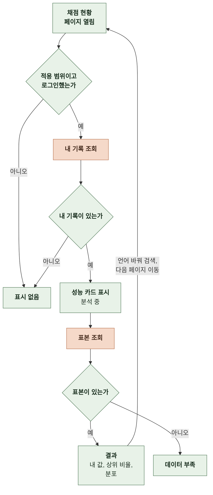

# 3-2 화면 흐름

기준: [화면 구성](3-1-INFORMATION-ARCHITECTURE.md).

 

### 3-2-1 페이지 진입

표시하지 않을 때는 성능 카드 자리를 비워 두지 않는다.

 

### 3-2-2 조작

| 조작 | 결과 |
|---|---|
| 안내 아이콘에 마우스를 올림 | 기준 채점 서버, 표본 크기, 언어 이름 툴팁 |
| 막대에 마우스를 올림 | 그 값과 제출 수 툴팁 |
| 언어 필터를 바꿔 검색 | BOJ가 페이지를 새로 열고 처음부터 다시 계산 |
| 결과 표의 다음 페이지로 이동 | 같은 문제의 페이지가 새로 열려 처음부터 다시 계산 |
