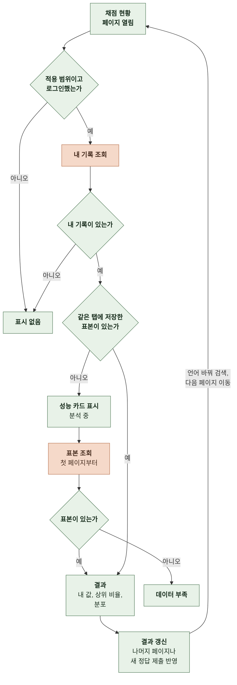

# 3-2 화면 흐름

기준: [화면 구성](3-1-INFORMATION-ARCHITECTURE.md).

 

### 3-2-1 페이지 진입

표시하지 않을 때는 성능 카드 자리를 비워 두지 않는다.

| 경우 | 결과를 처음 보이는 때 | 갱신 |
|---|---|---|
| 같은 탭에 저장한 표본 없음 | 표본 첫 페이지를 받은 직후 | 나머지 페이지를 받은 뒤 한 번 |
| 같은 탭에 저장한 표본 있음 | "분석 중" 없이 바로 | 새 정답 제출이 있을 때 한 번 |

 

### 3-2-2 조작

| 조작 | 결과 |
|---|---|
| 안내 아이콘에 마우스를 올림 | 표본 크기 툴팁 |
| 막대에 마우스를 올림 | 그 값이나 구간과 제출 수 툴팁 |
| 비교 언어 줄의 다른 언어 링크를 누름 | 그 언어 필터의 채점 현황이 열리고 그 언어로 다시 계산 |
| 언어 필터를 바꿔 검색 | BOJ가 페이지를 새로 열고 새 언어로 다시 계산 같은 탭에서 그 언어를 본 적이 있으면 저장한 표본으로 바로 보임 |
| 결과 표의 다음 페이지로 이동 | 같은 문제의 페이지가 새로 열려 저장한 표본으로 바로 보인 뒤 새 정답 제출 반영 |
