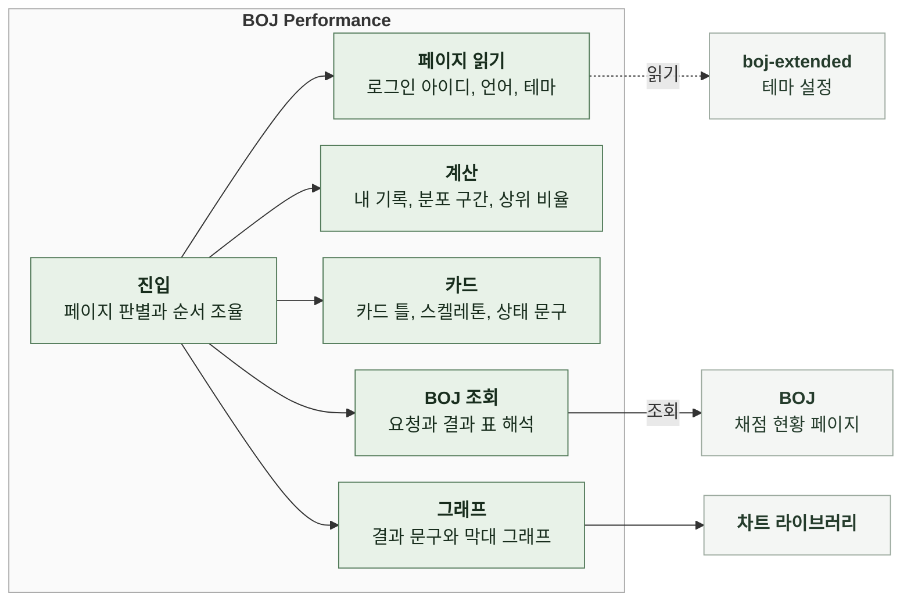

# 4-2 구성 요소 구조

기준: [연동 계약](4-1-CONTRACT.md), [화면 배치](3-3-LAYOUT.md).

 

### 4-2-1 구성 요소와 의존 방향

| 구성 요소 | 책임 | 하지 않는 것 |
|---|---|---|
| 진입 | 적용 범위와 로그인 판별 언어 필터로 비교 언어 정하기 테마 판정을 한 번 받아 카드와 그래프에 넘김 비교 언어 이름을 그래프에 넘김 내 기록, 카드, 저장한 표본, 표본, 계산, 그래프 순서 조율 | BOJ HTML 해석, 화면 요소 생성 |
| 페이지 읽기 | 현재 페이지의 로그인 아이디 읽기 언어 필터 값의 이름 찾기 테마 판정 | 요청 |
| BOJ 조회 | 요청 주소 구성 결과 표 행에서 제출 번호, 메모리, 시간, 내 제출의 언어 읽기 다음 페이지 따라가기, 저장한 표본에 닿으면 멈추기 표본의 세션 저장소 읽기, 쓰기, 새 행 합치기 | 계산, 화면 요소 생성 |
| 계산 | 내 기록 고르기 지표별 분포 구간과 내 값이 든 막대, 상위 비율 | 요청, 화면 요소 접근 |
| 카드 | 성능 카드 묶음 생성과 끼워 넣기 테마 색 적용 스켈레톤(분석 중), 데이터 부족 문구와 그 상태 알림 영역 | 결과 문구, 그래프, 테마 판정 |
| 그래프 | 결과 문구와 안내 툴팁 안내 아이콘과 그래프의 접근 가능한 이름, Esc 키로 안내 닫기 막대 색 결정과 그래프 그리기, 막대 툴팁 문구 | 요청, 계산, 테마 판정 |
| 차트 라이브러리 | 확장에 함께 묶은 외부 코드 막대 그래프 렌더링과 막대 툴팁 | 확장에 맞춘 수정 |

 

### 4-2-2 조립 경계

| 항목 | 규칙 |
|---|---|
| 실행 | 확장을 넣는 페이지가 열릴 때 구성 요소가 그 페이지에 함께 올라가고 진입이 한 번 실행됨 |
| 의존 순서 | 의존하는 구성 요소가 의존 대상보다 나중에 올라감 |
| 서버 | 확장 밖의 서버와 백그라운드 실행 없음 |
| HTML 삽입 | 카드와 그래프가 HTML로 넣는 값은 확장이 정한 문구와 계산한 숫자로 한정 BOJ 페이지에서 읽은 언어 이름과 링크 주소는 글자와 속성으로만 넣음 외부 입력을 넣지 않음 |
