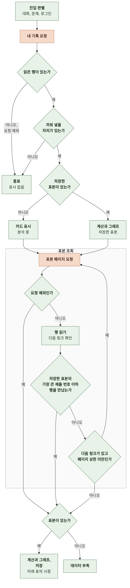

# 4-4 실행

기준: [성능 위치 요구](2-2-REQUIREMENTS.md#2-2-2-성능-위치), [연동 계약](4-1-CONTRACT.md), [상태 관리](4-3-STATE-MANAGEMENT.md).

 

### 4-4-1 요청 순서

저장한 표본이 없으면 "만났는가"는 늘 아니오다. 저장한 표본이 있으면 "표본이 있는가"는 늘 예다.

| 경우 | 그리는 시점 | 저장 |
|---|---|---|
| 저장한 표본 없음 | 첫 페이지의 행을 읽은 직후 조회가 끝났을 때 행이 늘었으면 한 번 더 | 예외 없이 끝나면 씀 |
| 저장한 표본 있음, 새 행 있음 | 조회 전 저장한 표본으로 예외 없이 끝나면 새 행을 앞에 붙여 200행으로 자른 표본으로 한 번 더 | 다시 그린 표본을 씀 |
| 저장한 표본 있음, 새 행 없음 | 조회 전 저장한 표본으로만 | 쓰지 않음 |
| 저장한 표본 있음, 요청 예외 | 조회 전 저장한 표본으로만 예외 전에 받은 새 행은 버림 | 쓰지도 지우지도 않음 |

다시 그릴 때 이전 그래프를 파기한다([4-3-1](4-3-STATE-MANAGEMENT.md#4-3-1-상태의-기준과-수명)). 페이지마다 다시 그리지 않는다.

| 항목 | 규칙 |
|---|---|
| 페이지 상한 | 저장한 표본이 있어도 10페이지 |
| 표본 요청 예외 | 개발자 도구 콘솔에 오류를 남김 |
| 응답 상태 | 상태 코드를 확인하지 않고 본문을 읽음 오류 페이지는 결과 표 행이 없는 응답으로 처리됨 |

 

### 4-4-2 BOJ 쪽 변경과 증상

결과 표 행이 0개인 응답은 내 기록 없음과 구분하지 않는다. 같은 탭에 저장한 표본이 있으면 표본 쪽 증상은 가려진다. 새 탭에서 확인한다.

| 변경 | 감지되는 상태 | 사용자에게 보이는 결과 |
|---|---|---|
| 요청 헤더 규칙이 적용되지 않거나 BOJ가 차단 방식을 바꿈 | 응답 본문이 비어 결과 표 행 0개 | 표시 없음 |
| BOJ 도메인이 확장을 넣는 페이지 목록 밖으로 바뀜 | 확장이 페이지에 올라가지 않음 | 표시 없음 |
| BOJ 도메인이 `host_permissions`나 요청 헤더 규칙의 적용 주소 밖으로 바뀜 | 헤더가 바뀌지 않아 빈 본문 | 표시 없음 |
| `.loginbar .username`이 바뀜 | 로그인하지 않은 것으로 판별 | 표시 없음 |
| `#status-table tbody tr`이 바뀜 | 결과 표 행 0개 | 표시 없음 |
| `.table-responsive`가 바뀜 | 끼워 넣을 자리 없음 | 표시 없음 |
| 결과 표의 메모리, 시간 열 순서가 바뀜 | 다른 열의 숫자를 읽거나 숫자가 없어 행을 건너뜀 | 틀린 값 표시 또는 표시 없음 |
| 결과 표의 제출 번호 열이 바뀜 | 표본 행을 모두 건너뛰거나 새 정답 제출을 잘못 가림 | 데이터 부족 또는 갱신 안 됨 |
| `#next_page`가 바뀜 | 첫 페이지에서 표본 조회 종료 | 표본이 첫 페이지 크기로 줄어듦 |
| `select[name="language_id"]`가 바뀜 | 언어 이름 없음 | 안내 툴팁에서 언어 이름이 빠짐 |
